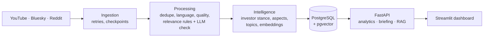

# Retail Investor Intelligence

**What retail investors are saying about your company, with the evidence behind every number.**

An analytics product for Investor Relations teams. It collects public posts about three listed
companies from YouTube, Bluesky and Reddit and filters out everything that isn't really about
the company. It labels what each post means for a shareholder and presents the result as an
executive briefing, interactive charts, the original posts, and an AI assistant whose answers
cite their sources.

| Company | Exchange | Industry |
|---|---|---|
| VEON Ltd. | NASDAQ: VEON | Telecommunications |
| Secure Trust Bank PLC | LSE: STB | Banking |
| Take-Two Interactive | NASDAQ: TTWO | Video games |

> Describes public conversation. Not investment advice, and not a prediction of share prices.

**Live demo:** hosted on Streamlit Community Cloud (see [Deployment](#deployment)).
**Architecture and design:** [`docs/ARCHITECTURE.md`](docs/ARCHITECTURE.md) and the draw.io
diagrams in [`docs/architecture.drawio`](docs/architecture.drawio).

---

## What it does

- **Executive briefing.** Shows a one-paragraph summary, the headline numbers with change
  against the previous period, *what to watch*, *what is going well* and the context. The text
  is written by fixed rules from the data, so it is instant, reproducible and quotes its
  numbers. It can be downloaded for an email or board pack.
- **Sentiment and platforms.** Shows the sentiment mix and trend, a platform comparison, the
  mix of opinion, news and market data, emerging concerns and data freshness.
- **Topics and aspects.** Shows what people discuss, and how they feel about each part of the
  business, such as debt, growth or the GTA VI launch. Representative posts sit behind every
  bar.
- **Post explorer.** Lists every collected post, including excluded ones and why. Each post has
  a link to the original and the model's one-line reason for its label.
- **Ask the data.** A question-answering assistant. The numbers come from database queries; the
  answer summarises retrieved posts and cites them. It says so when the evidence is too thin.
- **Method and reliability.** Shows measured accuracy in plain language, and what the data
  cannot tell you.
- **Refresh data.** One click collects new posts and analyses them, then updates every page.
- **Investor opinions only.** A switch that sets aside news headlines and automated market data
  to show what individuals think.

## How it works



1. **Collect.** One adapter per platform pages through search results, retries failures with
   backoff, and resumes from a checkpoint. Re-running never creates duplicates.
2. **Filter.**
   - Posts are normalised, deduplicated and checked for language and spam.
   - Keyword rules decide whether a post is about the company: "VEON" the telecom, not
     "Le'Veon" the footballer.
   - Posts the rules can't settle go to Claude Haiku.
3. **Understand.**
   - Claude Haiku labels each post's stance for a shareholder (positive, neutral or negative),
     its type (opinion, news, market data, question) and its view on specific business aspects.
   - FinBERT runs alongside as a baseline and fallback where PyTorch is installed.
   - Topics come from a fixed list per company; embeddings power semantic search.
4. **Serve.**
   - Every number is a SQL query.
   - The assistant plans the question, retrieves posts with combined keyword and vector search,
     asks Claude to answer only from that evidence, then removes any citation that doesn't
     match a retrieved post.

The full design, the five flows, trade-offs and roadmap are in
[`docs/ARCHITECTURE.md`](docs/ARCHITECTURE.md).

## Results

Measured with `python -m scripts.evaluate all`; the same numbers are shown on the *Method and
reliability* page.

| Measure | Result |
|---|---|
| Sentiment accuracy (54 labelled posts) | **87%** with the LLM investor stance, against 61% for FinBERT; macro F1 0.89 against 0.56 |
| Relevance filter (120 labelled posts) | F1 **0.94** (precision 0.98, recall 0.91), up from 0.80 |
| Retrieval (16 test questions, top 5) | Precision 0.50 hybrid, 0.53 vector only, 0.36 keyword only |
| Dashboard queries | 20 to 40 ms |
| Assistant answer | about 5 to 9 s (retrieval about 0.3 s; the rest is the model writing) |
| Cost | about $0.08 per 1,000 posts labelled; about $0.001 per assistant answer |
| Refresh | 62 new posts collected and analysed in 107 s |

**How to read these.**
- The reference labels were drafted with an AI model, which favours the LLM in the sentiment
  comparison.
- The relevance rules were refined using the same sample, so those numbers are optimistic.
- A fresh human-labelled set is the next step.

## Data

| Platform | Source | Posts |
|---|---|---|
| YouTube | YouTube Data API v3: videos and comments | 245 |
| Bluesky | AT Protocol search | 192 |
| Reddit | Adapter built and tested; API access is awaiting Reddit's approval, so the dashboard shows 14 clearly labelled synthetic posts | 14 (synthetic) |

There are 451 posts in total (VEON 116, Secure Trust Bank 93, Take-Two 242), collected from
August to November 2026. Secure Trust Bank is a small-cap with little public discussion, so its
collection reaches back a year. 225 posts pass every filter and count in the metrics. English
only: other languages are stored but not scored.

## Quick start

Requires Python 3.12 and PostgreSQL with pgvector (a free [Neon](https://neon.tech) database works).

```bash
python -m venv .venv
.venv\Scripts\activate                    # macOS/Linux: source .venv/bin/activate
pip install -r requirements.txt
# optional, for the FinBERT baseline:
#   pip install torch --index-url https://download.pytorch.org/whl/cpu && pip install -r requirements-ml.txt
cp .env.example .env                      # then fill in the keys below

python -m scripts.init_db                 # create tables, add the companies
python -m scripts.collect_data            # collect posts
python -m scripts.run_pipeline            # relevance, sentiment, topics, embeddings

streamlit run src/frontend/app.py         # dashboard at http://localhost:8501 (starts the API too)
uvicorn src.api.main:app --port 8000      # optional: run the API separately (docs at /docs)
```

Other commands:

| Command | Does |
|---|---|
| `python -m scripts.collect_data --health` | Checks each platform's credentials |
| `python -m scripts.run_pipeline --reprocess` | Re-labels everything after a rule or prompt change |
| `python -m scripts.scheduler` | Collects and analyses every 6 hours (`--once` for a single run) |
| `python -m scripts.evaluate all` | Measures relevance, sentiment, retrieval, ingestion and speed |
| `python -m scripts.seed_synthetic --platform reddit` | Loads the labelled synthetic Reddit posts (`--remove` to delete them) |
| `pytest` | Runs 92 tests; no network or database needed |

## Configuration

| Variable | Purpose |
|---|---|
| `DATABASE_URL` | PostgreSQL connection string (required) |
| `ANTHROPIC_API_KEY` | Investor stance, aspects, relevance checks and the assistant. Without it, FinBERT labels and a non-AI assistant answer are used |
| `LLM_MODEL`, `LLM_FAST_MODEL` | Claude model ids (default `claude-haiku-5-5`) |
| `YOUTUBE_API_KEY` | YouTube collection |
| `BLUESKY_HANDLE`, `BLUESKY_APP_PASSWORD` | Bluesky collection (use an app password) |
| `REDDIT_CLIENT_ID`, `REDDIT_CLIENT_SECRET`, `REDDIT_USER_AGENT` | Reddit collection once access is approved |
| `REFRESH_TOKEN` | Optional: require this token for refreshes started outside the dashboard |
| `REFRESH_COOLDOWN_MIN` | Minimum minutes between refreshes (default 15), to protect API quotas |
| `API_BASE_URL` | Where the dashboard finds the API (default `http://127.0.0.1:8000`) |

Companies, search terms and business aspects are configured in `config/companies.yaml`;
topics in `config/topics.yaml`.

## Deployment

**Streamlit Community Cloud (free).** The deployed app needs no PyTorch: embeddings run on
ONNX Runtime and Claude labels sentiment, so `requirements.txt` fits the free tier. Streamlit
Cloud runs only the dashboard process; the dashboard starts the API inside it on first load
(`ensure_backend` in `src/frontend/components/api.py`).

1. Push the repository to GitHub.
2. At [share.streamlit.io](https://share.streamlit.io), choose **Create app**, select the
   repository and branch `main`, and set the main file to `src/frontend/app.py`.
3. Under **Advanced settings**, choose Python **3.12** and paste the secrets in TOML format:
   ```toml
   DATABASE_URL = "postgresql://..."
   ANTHROPIC_API_KEY = "sk-ant-..."
   YOUTUBE_API_KEY = "..."
   BLUESKY_HANDLE = "you.bsky.social"
   BLUESKY_APP_PASSWORD = "..."
   ```
4. Deploy. Every push to `main` redeploys automatically.

A free app sleeps after a period without visitors and wakes on the next visit (about a minute).

**Any container host (Docker).** The `Dockerfile` builds the full version, including the
FinBERT baseline. `scripts/start_container.sh` runs the API internally and the dashboard on
`$PORT`. Railway, Render (paid plan) and Fly.io run it unchanged. Vercel is not suitable: it
runs short serverless functions, and this app needs a long-running server.

**Docker Compose (local).** Runs a local database, the API and the dashboard:

```bash
docker compose up --build
docker compose run --rm api python -m scripts.init_db
docker compose run --rm api python -m scripts.collect_data
docker compose run --rm api python -m scripts.run_pipeline
docker compose --profile scheduler up -d scheduler     # optional: refresh every 6 hours
```

## Limitations

- **Reddit:** posts are synthetic until Reddit approves API access. The adapter needs no code
  change: add the keys, remove the synthetic posts, refresh.
- **Small samples:** Secure Trust Bank in particular has little discussion. The dashboard warns
  below 30 posts.
- **Content mix:** most posts are news or automated market data rather than personal opinion;
  use *Investor opinions only*.
- **Model errors:** labels can miss sarcasm and slang. Every post shows the model's reason and
  a link to the source.
- **Representativeness:** public posters are not a representative sample of shareholders.
- **Retention:** posts deleted on a platform after collection are not yet removed automatically.

## Roadmap

- A human-labelled evaluation set.
- Streaming assistant answers.
- Alerts on growing concerns.
- Weighted fusion or a reranker for retrieval.
- Comparison with official disclosures.
- An Investor Concern Score once its weights are validated.
- Queue-based workers for scale.

See [`docs/ARCHITECTURE.md`](docs/ARCHITECTURE.md#7-taking-it-further).

## Repository

```text
config/        companies, aspects, topics and platform settings
src/
  ingestion/     platform adapters, HTTP client with retries, orchestrator
  processing/    normalisation, deduplication, quality, relevance rules and LLM check
  intelligence/  FinBERT, LLM stance and aspects, topics, embeddings, trends
  analytics/     SQL metrics, emerging concerns, executive briefing
  rag/           planner, hybrid retriever, prompts, LLM client, answer engine
  api/           FastAPI application and routes
  frontend/      Streamlit dashboard
scripts/       init_db, collect_data, run_pipeline, scheduler, evaluate, seed_synthetic, start_container.sh
data/eval/     labelled posts, test questions, latest results
docs/          ARCHITECTURE.md, architecture.drawio, blueprint.md (original design brief)
tests/         ingestion, normalisation, relevance, sentiment, retrieval, API
```
