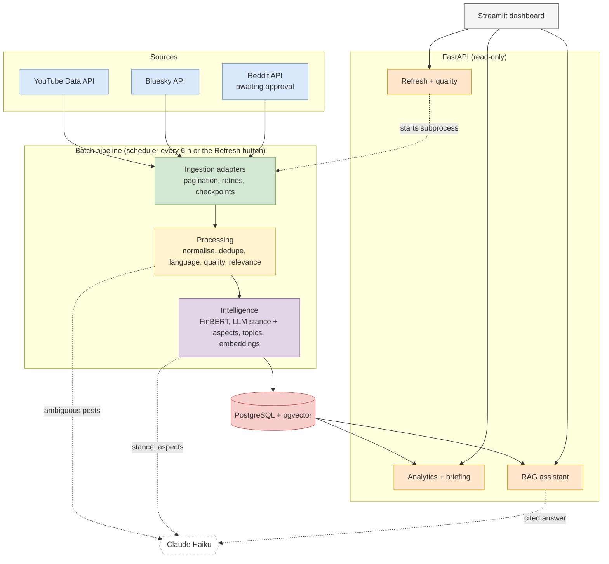
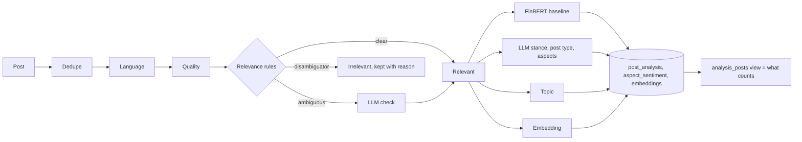
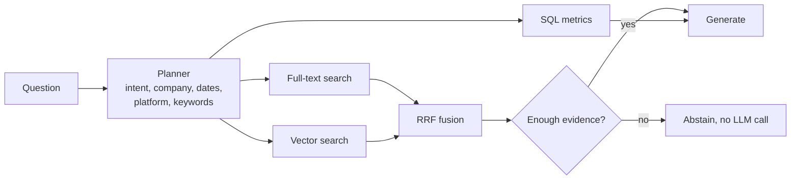

# Retail Investor Intelligence: architecture and design

A walk-through for presenting the system: what it does, how data and questions flow through it,
why it is built this way, what it trades off, and how it would grow.

**Diagrams:** [`architecture.drawio`](architecture.drawio) has five pages, one per section below.
Open it at [app.diagrams.net](https://app.diagrams.net) (File > Open from > Device) or with the
draw.io extension for VS Code. The Mermaid versions here render directly on GitHub.

| Page | Shows |
|---|---|
| 1. System architecture | Every component and how they connect |
| 2. Data and ML flow | One post's path from API record to a counted data point |
| 3. Assistant (RAG) flow | One question's path to a cited answer |
| 4. Deployment | GitHub to Streamlit Community Cloud, Docker, and the external services |
| 5. Design choices, trade-offs and roadmap | Decisions, when to revisit them, scaling and next steps |

---

## 1. The problem

Investor Relations (IR) teams need to know what retail investors say in public about their
company without reading thousands of posts on several sites. They need to know:
- what people discuss
- whether it is positive or negative, and why
- what is changing
- how platforms differ
- which posts back each finding

They also need to know what the data cannot tell them.

The product covers **VEON** (NASDAQ: VEON), **Secure Trust Bank PLC** (LSE: STB) and
**Take-Two Interactive** (NASDAQ: TTWO) on YouTube, Bluesky and Reddit.

Two rules shape everything:
1. **Every number comes from a database query.** AI models label posts and write explanations;
   they never estimate counts.
2. **Every finding is traceable to the posts behind it**, with a link to the original.

## 2. System architecture

- **Batch work runs in its own processes**: the scheduler, or the subprocess the Refresh button
  starts. The API that serves users only reads, and never loads the sentiment model.
- **One database** holds the relational data, the full-text index and the vectors.
- **A modular monolith.** Ingestion, processing, intelligence, analytics, retrieval and UI are
  separate packages with clear boundaries, deployed together.

## 3. The five flows

### Data flow: how a post becomes a record
1. An adapter calls the platform API with the company's search queries and pages through the
   results to a page or date limit.
2. Each raw record is normalised into one canonical schema (`src/database/models.py`):
   - platform id
   - text
   - author
   - `created_at` and `collected_at` kept separate
   - source URL
   - engagement, where NULL means unknown, not zero
3. It is upserted on `(company, platform, external_id)`, so re-running is safe.
4. Later runs start from the last checkpoint minus a 6-hour overlap.
5. Each run is logged in `ingestion_runs`, so the dashboard can show freshness and failures.
6. A failing platform is recorded and the others carry on.

### ML flow: how a post gets its labels

- **Relevance** comes before sentiment, so a negative post about the wrong company never
  affects the numbers.
  - Rules settle the clear cases. "Le'Veon Bell" and the Fortnite game "STB" are ruled out by
    disambiguators.
  - Ambiguous posts go to Claude Haiku, which returns a decision and a reason.
- **Sentiment** asks what the post means for a shareholder. FinBERT runs too, as a measured
  baseline and a fallback.
- **Aspects** split a post's view by business area, for example positive on growth and negative
  on debt.
- **Post type** separates personal opinion from news headlines and automated market data.
- Every label is stored with its model name and reason, so it can be audited and reprocessed.

### Retrieval flow: how a question becomes a search

- The planner is deterministic rules, not an agent, so its behaviour is predictable and testable.
- Both searches apply the same company, date and platform filters inside the query.
- Reciprocal Rank Fusion combines the two ranked lists, so a post found by both rises.

### Generation flow: how evidence becomes a cited answer
1. The prompt holds:
   - the question and its scope
   - the SQL metrics
   - up to 14 posts, wrapped as untrusted data
2. The model must use only the supplied evidence, quote numbers only from the metrics, report
   opinions as opinions, ignore instructions inside posts, and cite post ids.
3. The output is a validated schema: answer, themes with stance and evidence ids, limitations,
   and whether evidence is insufficient.
4. Citations are checked against what was actually retrieved. Unknown ids are removed, and a
   theme with no source is dropped.

### Scaling flow: 100,000 posts a day
See section 7 and diagram page 5.

## 4. Design choices and why

| Choice | Why |
|---|---|
| **No LangChain** | Each RAG step (plan, filter, retrieve, prompt, validate) is short, explicit code that can be read, tested and debugged. A framework earns its place when orchestration needs state, tool routing or multi-step plans. |
| **PostgreSQL + pgvector** | The product needs structured filters, joins and aggregates *and* semantic search. One store means one backup, one connection, and no keeping two databases in sync. |
| **SQL for every number** | Counts and percentages must be exact and repeatable. An LLM estimating from 14 retrieved posts would be wrong. |
| **Deterministic query planner** | Predictable, auditable routing; easy to unit test. |
| **LLM investor stance over FinBERT** | Measured: FinBERT 61% accuracy, LLM 87% on the same 54 labelled posts. FinBERT, trained on news sentences, put half the clearly positive and negative posts in "neutral". FinBERT is kept as baseline and fallback. |
| **Claude Haiku, low effort** | Assistant answers went from 13 s (Opus) to about 5 s, at about 1/25th of the cost, with answers still grounded and cited. |
| **Rule-based executive briefing** | The same data always gives the same sentences, instantly, and each sentence quotes its numbers. No risk of a model inventing a finding. |
| **Two-stage relevance** | Cheap rules for the clear majority; the LLM only for ambiguous posts (24 of 389). |
| **Post-weighted sentiment as default** | Engagement is not agreement and differs by platform; the engagement-weighted figure is shown separately and labelled. |
| **Topics from a fixed list** | Stable categories an IR team can report on month to month. Unsupervised topic discovery is a later experiment. |
| **No PyTorch in the deployed app** | Embeddings run on ONNX Runtime (fastembed, identical vectors to sentence-transformers) and Claude labels sentiment, so the app fits free hosting and starts in seconds. FinBERT stays as an optional install for the measured baseline. |
| **Refresh as a subprocess** | The API stays responsive and never loads FinBERT. One run at a time plus a cooldown protects the API quotas and LLM spend. |

## 5. Trade-offs

| Decision | MVP choice | Why | Reconsider when |
|---|---|---|---|
| Monolith vs microservices | Modular monolith | Faster to build, one deploy | Parts need to scale independently or teams split |
| Batch vs streaming | Scheduled batch + Refresh button | Hours-old data is enough for IR | Near-real-time alerts are required |
| SQL vs NoSQL | PostgreSQL | Relational analytics and filtering | Document workloads dominate |
| pgvector vs vector DB | pgvector | One database, simpler deployment | Vector load or features justify Qdrant or Pinecone |
| Fine-tuning vs prompting | Prompting (LLM stance) | No large labelled set | A measured gap on human-labelled data, or cost at scale |
| Vector vs hybrid retrieval | Hybrid with RRF | Exact tickers plus meaning | A larger evaluation favours weighting or a reranker |
| Agent vs planner | Deterministic planner | Predictable and auditable | Complex tool selection proves useful |
| LLM vs SQL for metrics | SQL | Deterministic numbers | Never |
| Large vs small LLM | Haiku, low effort | Latency and cost | Answer quality drops on harder questions |
| LLM vs rules for the briefing | Rules | Reproducible, instant | Users need narrative beyond rules |

## 6. Evaluation

Measured with `python -m scripts.evaluate all`; the results are on the dashboard's
*Method and reliability* page.

| What | Result |
|---|---|
| Relevance (120 posts) | F1 0.80 before the rule changes, 0.94 after (precision 0.98, recall 0.91) |
| Sentiment (54 posts) | FinBERT 61% accuracy, macro F1 0.56; LLM stance 87%, macro F1 0.89; always "neutral" 44% |
| Retrieval (16 questions, top 5) | Precision: vector 0.53, hybrid 0.50, keyword 0.36. MRR: vector 0.72, hybrid 0.69 |
| Speed | SQL queries 20 to 40 ms; retrieval about 0.3 s; assistant answer about 5 to 9 s |
| Cost | About $0.08 per 1,000 posts labelled; about $0.001 per assistant answer |
| Refresh | 62 new posts collected and analysed in 107 s |

**Caveats, stated up front:**
- The reference labels were drafted by an AI model, which favours the LLM in the sentiment
  comparison.
- The relevance rules were adjusted after studying errors on the same sample, so those numbers
  are optimistic.
- The next step is a fresh, human-labelled hold-out set.
- Vector search slightly beat the hybrid on this small question set. Hybrid stays for exact
  tickers and names; the weighting will be tuned on a larger set rather than on these 16
  questions.

## 7. Taking it further

### Scaling to 100,000 posts a day

| Today | At scale |
|---|---|
| APScheduler / Refresh subprocess | Airflow or Prefect with retries and backfills |
| Direct API calls in one process | Ingestion workers per platform |
| In-process labelling | Message queue (Redis or RabbitMQ) with relevance, stance and embedding workers that scale independently |
| One LLM call per 10 posts | Batched or asynchronous LLM calls; distil the LLM stance into a small fine-tuned model to cut cost |
| PostgreSQL | Partitioned by month, plus object storage for raw payloads |
| pgvector | A dedicated vector database only if measured load requires it |
| Streamlit | React or Next.js with authentication and roles per company |
| Local logs | Centralised logs, metrics, traces, LLM token and cost tracking, freshness alerts |

Don't add Kafka, Kubernetes or microservices just to look sophisticated. Each one should answer
a measured need.

### Roadmap

- **Now:**
  - A human-labelled hold-out set.
  - Streaming assistant answers.
  - A retention job for posts deleted at the source.
  - Real Reddit data once Reddit approves API access.
- **Next:**
  - Alerts on growing concerns.
  - A reranker or weighted fusion.
  - Comparison with official disclosures.
  - More languages.
- **Later:**
  - An **Investor Concern Score**: volume, growth, negative share and platform breadth
    combined once the weights are validated. Today the components are shown side by side.
  - A fine-tuned stance model.
  - Multi-tenant SaaS.

## 8. Security and governance

- **Secrets:** environment variables or Space secrets; `.env` is git-ignored.
- **Database:** parameterised SQL everywhere; input validated with Pydantic.
- **Abuse limits:** rate limit on the assistant; one run at a time, a cooldown and an optional
  token on Refresh.
- **Untrusted text:** social posts are treated as untrusted in every prompt, and instructions
  inside them are ignored.
- **Labelling:** synthetic data is always labelled; the product never presents it as real.
- **Scope:** describes public conversation; no investment advice or price prediction.
- **Commercial deployment** would add authentication, role-based access, tenant isolation and
  per-platform retention policies.

## 9. Risks and limitations

- **Platform access:** Reddit is awaiting approval (the adapter is built; its posts are
  labelled synthetic).
- **Sample size:** the data is small and noisy. STB has little discussion, and the dashboard
  warns below 30 posts.
- **Representativeness:** public posters are not a representative sample of shareholders.
- **Model errors:** the models can miss sarcasm and slang. Each post shows the model's reason,
  and the source link lets anyone check.
- **Content mix:** most posts are news or market data. The "Investor opinions only" switch
  isolates personal views.

## 10. Questions to expect

- **Why these platforms?** Retail-investor relevance, public access, cost and time to build.
  Reddit was chosen but is blocked on approval, so it is labelled synthetic.
- **What if a platform API goes down?** Adapters are independent and retries are built in. The
  failed run is logged as partial or failed, and the freshness table shows it.
- **How are duplicates prevented?** A unique constraint on platform id, idempotent upserts, and
  a text hash for re-posts.
- **Why not a vector database?** One store does analytics and semantic search; a separate one
  is added only when measured load needs it.
- **How do you handle sarcasm and class imbalance?** Macro F1 and per-class recall (not
  accuracy), a labelled set that includes sarcasm, and a reason shown under every label.
- **How do you prevent hallucination?** Filtered retrieval, evidence-only prompts, structured
  output, citation validation, and abstaining when evidence is thin.
- **How do you answer numerical questions?** SQL computes them; the model only explains them.
- **Why RAG, not fine-tuning?** New posts are usable immediately, without retraining, and every
  claim can cite its source.
- **What would you build next?** A human-labelled evaluation set, concern alerts, and comparison
  with official disclosures.
